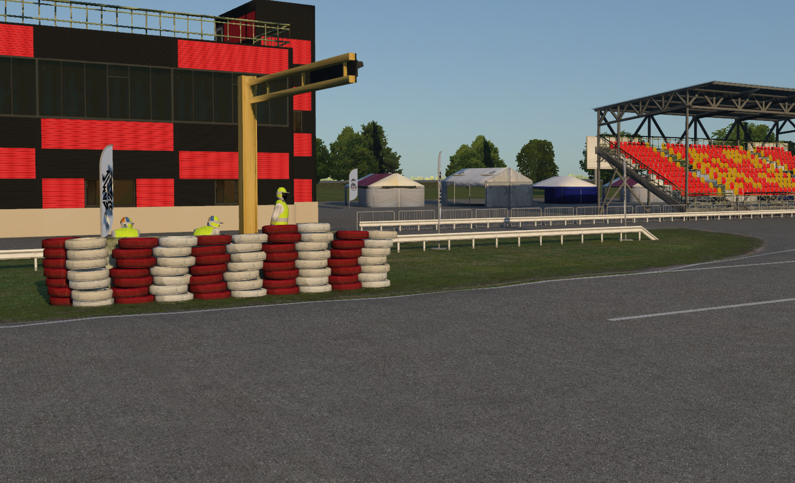

# Red Ring для Live for Speed



Карта **HighSpeedGarage**, адаптированная для Live for Speed.
Цепочка конвертации: **Assetto Corsa → BeamNG.drive → LFS**.

## Скачать и установить

Скачайте [red_ring.zip из релиза v1](https://github.com/insomniaws/LFS-REDRING/releases/download/v1/red_ring.zip).
Закройте LFS и распакуйте папку `red_ring` из архива в `LFS/mods/tracks/`.
Итоговый путь: `LFS/mods/tracks/red_ring/track.txt`.
Запустите игру и выберите **Red Ring**, код **RR**, конфигурация **Circuit**.

Требуется LFS S3 и совместимый загрузчик lfs-custom-track.
Версия проверялась с LFS 0.8C и загрузчиком d3d11.dll от 2026.11.16.
Игра и загрузчик в архив не включены.

## Что входит

- Оптимизированный рельеф и повторяющиеся текстуры покрытия.
- Деревья из плоскостей вокруг трассы и исправленные модели покрышек.
- Ночное освещение трассы и зданий.
- Две гаражные позиции по сторонам отбойника для парного дрифта.
- Две позиции стартовой решётки.

Гаражные позиции распределяет сама LFS. Для смены позиции используйте штатный выход из боксов; отдельной кнопки Lead/Chase нет.
Для совместного заезда всем участникам нужна одинаковая версия карты.

## Ограничения

Зелёная линза светофора декоративная. Освещение фонарей и его тени запечены.
Карта предназначена прежде всего для свободной езды и дрифта; AI, хронометраж и отдельный онлайн-тест парного старта не подтверждены.

## Авторство

**HighSpeedGarage** — автор исходной карты. Версия для LFS является её дальнейшей конвертацией через BeamNG.drive.

## Get mods

Добавьте в `LFS/mods/repositories.txt` отдельную строку:

```text
insomniaws/LFS-REDRING
```

Перезапустите LFS и найдите Red Ring в Get mods.

[Изменения](CHANGELOG.md) · [Техническая проверка](docs/VALIDATION.md)
